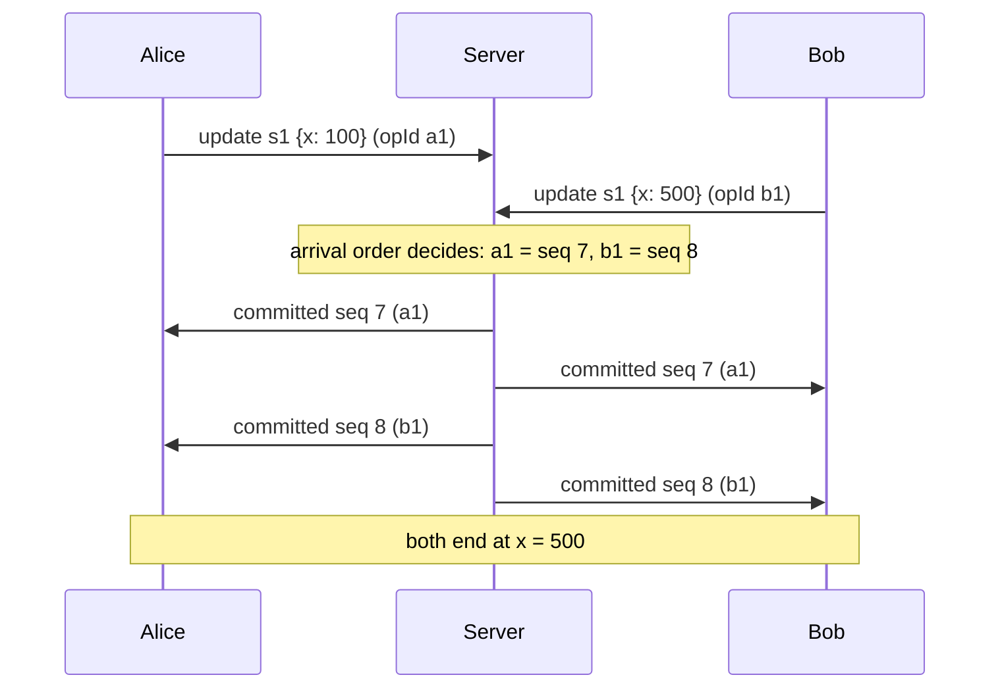
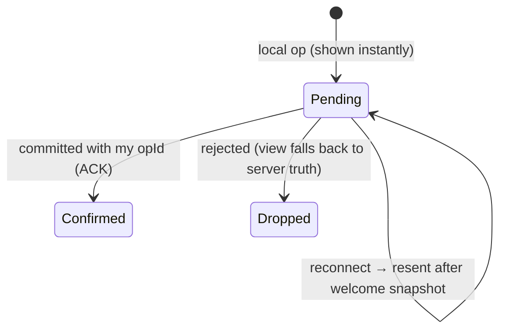

# Collab Canvas: design notes

How the whiteboard works, compared with the Google Docs clone in `../google-docs`.

## 1. Is the server authoritative, like Google Docs?

**Yes.** Each board lives on one server, in one `Board` object, guarded by one lock. The server
gives every accepted op a sequence number (`seq`) and broadcasts it. That broadcast order *is*
the board's history. Clients never decide what is "really" on the board; they only show a
prediction until the server confirms.

What differs is **how much work the server must do to merge concurrent edits**:

| | Google Docs clone | Collab Canvas |
|---|---|---|
| Op addresses… | a **position** in one string (`retain 5, insert "x"`) | a **shape id** (`update s42 {x: 300}`) |
| Concurrent edits | shift each other's positions → must **transform** (OT) | touch independent objects → no transform needed |
| Same target, same time | OT merges both inserts | **last writer wins per field** (in `seq` order) |
| Edit on deleted target | OT turns it into a no-op | rejected with `shape_deleted` |
| Server stores | text snapshot + op history | shape map snapshot (+ `seq`) |

Text needs OT because "insert at 5" means something different once someone else inserted at 2.
A drawing is a **set of independent objects**. Moving shape A and recoloring shape B never
conflict. Two people moving the *same* shape is a genuine conflict that LWW resolves the way
users expect (the last drop wins). That's the same model Figma documents for its multiplayer.

## 2. Is each paint a revision, like a doc edit?

**Each finished gesture is one op**, not each pixel or mouse event:

| Gesture | Ops sent |
|---|---|
| Pen stroke | 1 `add STROKE` at pointer-up (points simplified to ≥ 1.5 px apart, ≤ 5000) |
| Rect / ellipse / line / arrow | 1 `add` at pointer-up |
| Move | 1 `update {x, y}` at drop |
| Restyle selected | 1 `update {stroke}` / `{fill}` / `{width}` |
| Delete key | 1 `delete` |
| Eraser drag | `delete` batches every 100 ms (one undo step for the whole drag) |

So yes, an op plays the role of a revision. But two things are deliberately **not** revisions:

- **Live previews.** While you draw, the tab streams the new points every 50 ms as `preview`
  messages. The server validates and relays them to peers and **never stores them**. Peers see
  the line grow smoothly; the board history only gets the one final `add`.
- **Cursors.** Relayed and throttled (20/s from the client, ≤ 60/s per connection on the server).

Ephemeral traffic is the reason this project uses **WebSocket** instead of the Docs clone's
POST + SSE: dozens of small messages per second in both directions.

## Client: optimistic state

`board-state.js` keeps:

- `serverShapes`: the state as of the last `committed` message (truth);
- `pending`: my ops, sent but not yet echoed back;
- `view = serverShapes + pending replayed in order`: what gets drawn.

Unlike the Docs clone, there's no "one op in flight" rule and no rebasing. Replaying pending
ops on top of a newer server state is always well-defined: an update of a shape that's gone
is simply skipped. The server sends one `committed` stream to everyone, author included, so
every replica applies the same ops in the same order and converges.

## Undo / redo

Undo is **per user** and **never rewinds shared history**. Recording an action stores its
inverse, computed against the board just before it:

- `add s` → `delete s`
- `delete s` → `add` (the old shape, without server-owned `author`/`version`)
- `update s {x: 9}` → `update s {x: <old x>}` (only the fields I changed)

Undo sends the inverse as **new ops** through the normal path. If a peer has since deleted the
shape, that inverse is dropped and undo moves on to your next older action. If a peer
recolored a shape you then un-move, their color survives because only `x` is reverted. Redo
inverts the undo against the board at undo time.

## Ordering (z)

New shapes take a z key just above the current maximum (`zAfter`, base62 in ASCII order).
Painting order is `(z, id)` with plain string comparison, the same on client and server, so
two peers adding at once both land on top in a deterministic order.

## Server internals

- `Board.apply` (under the lock): validate against current state → `seq++` → apply → enqueue
  `committed` to every peer. Rejects go only to the author and use no `seq`.
- `Board.join` enqueues the `welcome` snapshot under the same lock, so a joiner never misses or
  double-applies an op that races with the join.
- Each `Peer` has a bounded queue (1024) drained by its own virtual thread, which is the only socket
  writer. A peer too slow to drain is disconnected (1013) instead of stalling the board; on
  reconnect it gets a fresh snapshot.

## Security

- **Untrusted input is allow-listed** (`OpValidator`): exact field sets, id/color/z regexes,
  finite bounded numbers, point-count caps. `author`/`version` can't be supplied by clients.
- **Cross-site WebSocket hijacking**: handshake `Origin` must be in `app.allowed-origins`
  (wildcards ignored). Unknown boards get 404 before the upgrade.
- **Abuse**: per-connection token buckets (ops, ephemeral), message size cap (256 KB),
  repeated invalid messages → close 1008, caps on shapes/points/peers/boards, REST rate limit.
- **Browser**: strict CSP (`script-src 'self'`, no inline code), `nosniff`, `X-Frame-Options: DENY`,
  `Referrer-Policy: no-referrer` (board URLs are capabilities), Permissions-Policy. All
  peer-supplied text is rendered with `textContent` or canvas `fillText`, never as HTML.
- **Binding**: 127.0.0.1 by default. Expose it only behind TLS (`wss://`) and set `ALLOWED_ORIGINS`.
- **Known gaps** (`TODO(security)`): no authentication (anyone with the link can edit, by
  design for this exercise); REST rate-limit map resets instead of LRU-evicting.

## Not built (next steps)

- Persistence: append-only op log + periodic snapshot (same as the Docs discussion), so boards
  survive restarts and support history/restore.
- Horizontal scale: route each board id to one owner node (consistent hashing). The single
  authoritative `Board` per id stays the same.
- Pan/zoom, resize handles, multi-select, text, PNG export.
