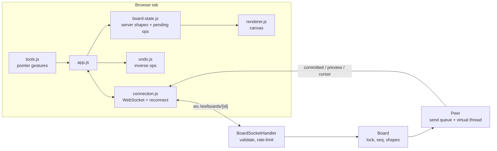
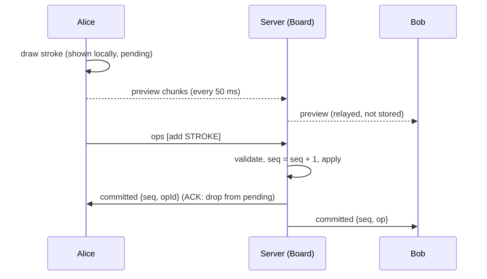

# Collab Canvas

A real-time collaborative whiteboard: freehand pen, rectangles, ellipses, lines and arrows,
select/move/delete, eraser, per-user undo/redo, live stroke previews and peer cursors.
Java 21 + Spring Boot (WebSocket) on the server, vanilla JS + `<canvas>` in the browser.

See [DESIGN.md](DESIGN.md) for why it works this way (and how it differs from the Google Docs clone).

## Run

```bash
./run.sh start      # builds if needed, serves http://127.0.0.1:8090/
./run.sh status
./run.sh stop
./run.sh fg         # foreground
./run.sh test       # Java tests (unit + WebSocket integration) and JS tests
```

Open `http://127.0.0.1:8090/`. It creates a board and redirects to `/b/<board-id>`.
Use **Copy link** and open it in another window (e.g. Chrome Incognito) to collaborate.

| Shortcut | Action |
|---|---|
| `V` `P` `R` `O` `L` `A` `E` | select, pen, rect, ellipse, line, arrow, eraser |
| `Cmd/Ctrl+Z`, `Shift+Cmd/Ctrl+Z` (`Ctrl+Y`) | undo / redo (your own changes only) |
| `Delete` / `Backspace` | delete selected shape |
| `Esc` | cancel gesture / clear selection |

Environment: `SERVER_PORT` (8090), `SERVER_HOST` (127.0.0.1), `ALLOWED_ORIGINS`
(comma-separated; must list the exact origin users load the page from), `JAVA_HOME`.

> Boards live only in server memory. A restart (or 24 h with nobody connected) clears them.

## Architecture





## Layout

```
src/main/java/com/collabcanvas/
  model/       Shape, ShapePatch, Op (add / update / delete)
  board/       Board (authoritative state), Peer, OpValidator, Wire, RateLimiter, BoardRegistry
  ws/          BoardSocketHandler
  config/      WebSocketConfig (origin allow-list), SecurityConfig (CSP, headers, rate limit)
  web/         BoardController (REST)
src/main/resources/static/
  index.html, styles.css, js/*.js
src/test/java/   Board, validator, concurrency, end-to-end WebSocket tests
src/test/js/     JavaScriptCore tests for geometry, board-state, undo (run-js-tests.sh)
```

## Protocol

Client → server (WebSocket text frames, ≤ 256 KB):

| Message | Notes |
|---|---|
| `{"t":"ops","ops":[{opId, kind:"add", shape}, {opId, kind:"update", id, set}, {opId, kind:"delete", id}]}` | ≤ 100 ops; each committed or rejected on its own |
| `{"t":"preview","sid","pts":[x,y,...],"stroke","width","done"}` | live pen stroke, relayed only |
| `{"t":"cursor","x","y"}` | relayed only |

Server → client: `welcome` (snapshot + identity + peers), `committed` (to everyone, including the
author as its ACK), `rejected` (author only), `presence`, `preview`, `cursor`, `error`.

REST: `POST /api/boards` → `201 {boardId}`, `GET /api/boards/{id}` → `{boardId, seq, peers}`,
`GET /api/health`.

## Limits

20k shapes and 2M stroke coordinates per board, 5k points per stroke, 50 peers per board,
1000 boards per server, 50 ops/s (burst 200) and 60 previews+cursors/s per connection,
120 REST requests/min per IP. Coordinates are bounded to ±100000; the canvas is 4000×3000.
